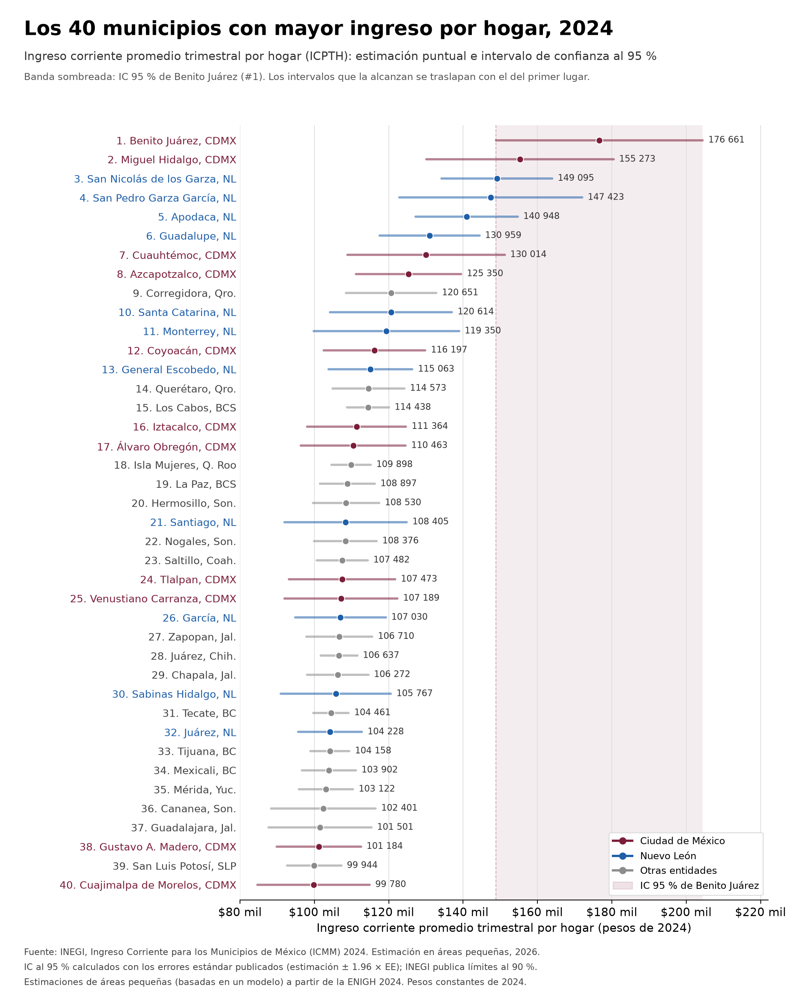

# Ingreso por hogar en municipios de México (INEGI, ICMM 2024) con intervalos de confianza

Reproduce la gráfica de INEGI de los 40 municipios con mayor ingreso corriente promedio trimestral por hogar (2024), agregando intervalos de confianza al 95 % calculados con los errores estándar que el propio INEGI publica.



## Fuente

- INEGI, *Ingreso Corriente para los Municipios de México (ICMM) 2024*, publicado el 28 de septiembre de 2026.
  - Comunicado de prensa: https://www.inegi.org.mx/contenidos/saladeprensa/boletines/2026/ICMM/ICMM2024_CP.pdf
  - Reporte de resultados: https://www.inegi.org.mx/contenidos/saladeprensa/boletines/2026/ICMM/ICMM2024_RR.pdf
  - Tabulados: https://www.inegi.org.mx/contenidos/investigacion/icmm/tabulados/icmm_2024_tabulados.xlsx
  - Datos abiertos: https://www.inegi.org.mx/contenidos/investigacion/icmm/datosabiertos/conjunto_de_datos_icmm_2024_csv.zip

Las copias de los tabulados y de los datos abiertos están en `datos_inegi/`.

## Notas metodológicas

- Son estimaciones de áreas pequeñas (basadas en un modelo) construidas a partir de la ENIGH 2024. No son estimaciones directas de la encuesta.
- Montos en pesos constantes de 2024, ingreso corriente trimestral por hogar.
- INEGI publica límites de confianza al 90 %. Aquí se usan intervalos al 95 %: estimación ± 1.96 × EE.
- `ztest.py` compara al #1 contra cada municipio con una prueba z de diferencia. Supone estimaciones independientes, lo cual es una simplificación porque todas salen del mismo modelo e INEGI no publica covarianzas.
- Los errores estándar solo reflejan el error de muestreo y del modelo, no el error ajeno al muestreo.

## Uso

```bash
pip install -r requirements.txt
python extract.py   # genera datos.csv a partir de los tabulados (y lo cruza con datos abiertos)
python plot.py      # genera ingreso_municipal_ic95.png
python ztest.py     # genera ztest_vs_1.csv
```
